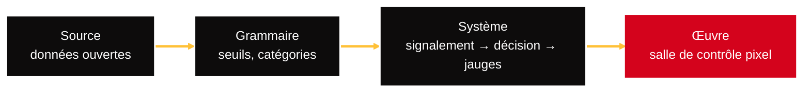

PATRIMOINE.EXE · NTE001 — ESD Nantes, B3 Design

<h1 class="titre-cover"><AutoFitText :max="64" :min="32" modelValue="Nantes en régulation" /></h1>

Rejouer une semaine réelle du réseau nantais, en salle de contrôle.

9, 10 & 12 novembre 2026 · œuvre <code>PXE-NTE001-G01-W01</code>

<!--
Bonjour. Nous présentons « Nantes en régulation », notre œuvre du workshop PATRIMOINE.EXE.
Navigation : ← → pour avancer, Début / Fin pour les extrémités.
-->

---
layout: intro
hideInToc: true
---

# Le projet en une phrase

Un jeu de régulation où chaque incident vient d'une **donnée ouverte réelle** de Nantes Métropole.

- Auteurs : Mattéo Brevet & Guillaume Renoult (crédits du jeu, licence MIT)
- Groupe G01 · cours de Kamel Ghabte
- Jouable au navigateur, hors ligne : [workshop-design-interactions.pages.dev](https://workshop-design-interactions.pages.dev/)

<!--
On se présente, on dit d'où vient le projet : un atelier de trois jours, une source patrimoniale, une œuvre jouable.
-->

---
hideInToc: true
---

# Sommaire

<Toc columns="2" minDepth="1" maxDepth="1" />

<!--
Cinq actes : le projet, la chaîne, les sources, le jeu, jouer. Les numéros de diapositive sont en bas à droite.
-->

---
layout: section
transition: slide-left
---

# Le projet

Une question, une contrainte : rien d'inventé

<!--
Premier acte : la question de départ.
-->

---
layout: quote
hideInToc: true
---

# La question

> « Rejouer une semaine réelle du réseau de transports nantais et prendre, en salle de contrôle, les décisions de régulation qui préservent la fluidité du réseau — chaque incident réel devenant un dossier à trancher. »

Thème : tram, busway, bus · rôle : régulateur · une semaine de journées réelles

<!--
La phrase-problématique est restée stable depuis le premier jour (jeu/00-concept.md).
[click] Le thème, le rôle, la durée.
-->

---
layout: statement
hideInToc: true
---

# 0 événement inventé

Chaque dossier, chaque notification, chaque tâche vient d'une donnée réelle — ou de la partie elle-même, et c'est alors écrit.

<!--
C'est notre contrainte de design la plus forte : quand la source ne dit pas la ligne ou la durée, le jeu l'affiche comme « non précisé ».
-->

---
layout: section
transition: slide-left
---

# La chaîne

Source → grammaire → système → œuvre

<!--
Deuxième acte : comment une donnée devient une décision de jeu.
-->

---
hideInToc: true
---

# Source → grammaire → système → œuvre

<v-clicks>

- **Source** : Naolib (offre, perturbations, temps réel), agenda, météo, Loire
- **Grammaire** : un seuil, des alertes, cinq catégories de problème
- **Système** : signalement → lecture → réponse → jauges, rythmé par la journée
- **Œuvre** : une salle de contrôle en pixel art, jouable au navigateur

</v-clicks>

<!--
Le diagramme résume toute la démarche du cours.
[click] La source : uniquement des données ouvertes.
[click] La grammaire : des règles explicites.
[click] Le système : une boucle courte.
[click] L'œuvre : une pièce où l'on s'assoit.
-->

---
layout: fact
hideInToc: true
---

# ≥ 10 min

de retard réel sur une ligne : le seuil qui transforme une mesure du réseau en dossier à trancher

<!--
Le seuil est l'invariant central de la grammaire. Il vient du flux temps réel (GTFS-RT).
-->

---
layout: two-cols-header
hideInToc: true
---

# La grammaire

::left::

### Invariants

<v-clicks>

- Seuil de retard : 10 min
- 4 réponses par catégorie, dont « attendre »
- 3 jauges : fluidité, réputation, budget
- Un dé à 6 faces sur l'amplitude des effets

</v-clicks>

::right::

### Variables

<v-clicks>

- La semaine rejouée (facile, normale, difficile)
- La météo réelle du jour
- L'heure de pointe
- L'agenda des événements

</v-clicks>

<!--
Les invariants ne bougent jamais ; les variables viennent des données de la semaine choisie.
Catégories calculées sur les champs réels : accident > météo > retard > travaux > affluence.
-->

---
layout: section
transition: slide-left
---

# Les sources réelles

Données ouvertes, licences vérifiées

<!--
Troisième acte : d'où viennent les données, et sous quelles licences.
-->

---
layout: two-cols
hideInToc: true
---

# Les sources

<v-clicks>

- **Naolib, offre et perturbations** (GTFS + changelog daté) — Licence Ouverte — [jeu de données](https://data.nantesmetropole.fr/explore/dataset/244400404_transports_commun_naolib_nantes_metropole_gtfs/)
- **Naolib, temps réel** (GTFS-RT, retards par ligne) — Licence Ouverte
- **Agenda** de Nantes Métropole — Licence Ouverte — [API](https://data.nantesmetropole.fr/explore/dataset/244400404_agenda-evenements-nantes-metropole_v2/)

</v-clicks>

::right::

<v-clicks>

- **Météo** Open-Meteo (archive ERA5) — CC BY 4.0 — [open-meteo.com](https://open-meteo.com/)
- **Loire** à Nantes (Hub'Eau, station M800001010) — Licence Ouverte Etalab
- **En direct** sur le téléphone : parkings, vélos, trafic, pollens
- **Hors ligne** : instantanés réels datés, rejoués sans réseau

</v-clicks>

<!--
Licences vérifiées à la source le 10 et le 11 novembre (fiche-source, manifest.json).
Le téléphone n'interroge le direct qu'au clic, jamais en boucle.
-->

---
layout: section
transition: slide-left
---

# Le jeu

Lire, décider, assumer

<!--
Quatrième acte : ce que le joueur voit et fait.
-->

---
layout: image-right
image: /img/decision.webp
backgroundSize: contain
hideInToc: true
---

# Décider, sans chrono

<v-clicks>

- Un signalement s'ouvre : l'**horloge se met en pause**
- Trois blocs : ce qui se passe, pourquoi, ce qu'on sait
- Quatre réponses propres à la catégorie
- La pression vient de la journée : le retard s'aggrave en file

</v-clicks>

horloge en pause
<Arrow x1="850" y1="126" x2="872" y2="176" color="#FFC138" width="3" />
3 blocs
<Arrow x1="640" y1="428" x2="712" y2="220" color="#FFC138" width="3" />
réponses
<Arrow x1="830" y1="428" x2="816" y2="350" color="#FFC138" width="3" />
trace du jour
<Arrow x1="540" y1="126" x2="580" y2="238" color="#FFC138" width="3" />

<!--
Depuis le prompt 87, plus de compteur par décision : on lit à son rythme.
[click] La pause. [click] Les trois blocs. [click] Les réponses. [click] La pression vient du retard qui grimpe.
-->

---
layout: image-left
image: /img/sources.webp
backgroundSize: contain
hideInToc: true
---

# Enquêter

<v-clicks>

- « En savoir plus » : quatre sources à consulter (touches 5 à 8)
- Chaque source est une **carte** : fait principal, détails, citation exacte
- La citation n'est jamais reformulée
- Lecture vocale du texte complet ; Tab et Entrée au clavier

</v-clicks>

consultée à…
<Arrow x1="360" y1="126" x2="400" y2="226" color="#FFC138" width="3" />
fait principal
<Arrow x1="90" y1="126" x2="214" y2="236" color="#FFC138" width="3" />
citation exacte
<Arrow x1="180" y1="428" x2="266" y2="262" color="#FFC138" width="3" />

<!--
Le prompt 92 a rendu les textes d'enquête lisibles : cartes hiérarchisées, coupure réelle, « Lire tout ».
[click] Les sources. [click] La carte. [click] La citation intacte. [click] L'accessibilité.
-->

---
layout: full
hideInToc: true
---

  

<h1 class="titre-sur-image">La salle de contrôle</h1>
pluie réelle du jour
<Arrow x1="170" y1="158" x2="172" y2="100" color="#FFC138" width="3" />
PC RégulOS
<Arrow x1="490" y1="328" x2="490" y2="232" color="#FFC138" width="3" />
horloge
<Arrow x1="850" y1="148" x2="872" y2="92" color="#FFC138" width="3" />
téléphone
<Arrow x1="740" y1="498" x2="784" y2="474" color="#FFC138" width="3" />

<!--
Une pièce vue depuis la chaise : baie sur la ville, la Loire, la grue Titan, la météo réelle à la fenêtre.
On s'installe au PC, on se lève pour téléphoner, on finit la journée à l'horloge.
-->

---
layout: image-right
image: /img/telephone.webp
backgroundSize: contain
hideInToc: true
---

# La ville au téléphone

<v-clicks>

- Une appli par source : agenda, météo, travaux, Loire, messages
- Au plus une notification toutes les 20 min de jeu
- Onglet « En direct aujourd'hui », jamais daté de la semaine jouée
- **Ne pas déranger** : seules les alertes passent

</v-clicks>

onglets
<Arrow x1="660" y1="126" x2="722" y2="196" color="#FFC138" width="3" />
source + heure
<Arrow x1="660" y1="428" x2="722" y2="238" color="#FFC138" width="3" />

<!--
Le téléphone donne la ville en arrière-plan, sans jamais interrompre une décision.
-->

---
layout: image-left
image: /img/journal.webp
backgroundSize: contain
hideInToc: true
---

# Le journal de bord

<v-clicks>

- Pastilles des journées, objectif tenu ou raté
- Tuiles : signalements, bons choix, jauges en mini-courbes
- Frise horaire des décisions, filtres, vue Semaine
- Enquête après coup : source, contexte, dés, effets

</v-clicks>

tuiles
<Arrow x1="210" y1="126" x2="234" y2="190" color="#FFC138" width="3" />
frise de la journée
<Arrow x1="130" y1="428" x2="172" y2="262" color="#FFC138" width="3" />
enquêter
<Arrow x1="400" y1="428" x2="418" y2="258" color="#FFC138" width="3" />

<!--
Le journal raconte la journée avec les vraies valeurs : on comprend après coup pourquoi une réponse était meilleure.
-->

---
layout: two-cols
hideInToc: true
---

# Les interactions

<v-clicks>

- **Clavier** : tout le jeu (1 à 4, 0, E, J, H, L)
- **Souris** et **toucher**, paysage ou portrait
- **Micro** (M maintenue) : souffler calme le cœur
- **Webcam** désactivée par défaut, aucune image envoyée

</v-clicks>

::right::

## Accessibilité, hors ligne

<v-clicks>

- Contraste ≥ 4,5:1, focus visible, lecteurs d'écran
- Animations réduites respectées, aucun flash
- Palettes daltonisme, taille du texte, lecture facile
- Jouable sans son et **hors ligne** (service worker)

</v-clicks>

<!--
Le jeu se joue au clavier seul, sans son, et sans réseau : c'est une exigence du livret.
-->

---
layout: section
transition: slide-left
---

# Jouer

Le jeu, le cartel, le making-of

<!--
Dernier acte : où trouver l'œuvre et ses livrables.
-->

---
layout: center
hideInToc: true
---

# À vous de réguler

<a href="https://workshop-design-interactions.pages.dev/">workshop-design-interactions.pages.dev</a>

Tous les livrables : <Link to="livrables">voir la diapositive des livrables</Link>

<!--
On lance le jeu en direct si le temps le permet ; sinon, la vidéo de démonstration du cartel.
-->

---
routeAlias: livrables
hideInToc: true
---

# Les livrables

<v-clicks>

- Le jeu : [workshop-design-interactions.pages.dev](https://workshop-design-interactions.pages.dev/)
- Le cartel : [/cartel/](/cartel/) — captation (hero, détail, process, démo) et QR codes
- La chaîne des prompts : [/making-of/](/making-of/)
- `manifest.json`, fiche-source, grammaire, version archivée relançable (`rendu/`)
- Tests : trois semaines rejouées à chaque `npm test`, audit des textes `?audit=textes`

</v-clicks>

<!--
Tout est versionné dans le dépôt ; la version archivée se lance sans réseau en double-cliquant index.html.
-->

---
layout: center
hideInToc: true
---

# Crédits

- Musiques libres **CC0** : Komiku, Loyalty Freak Music — détail dans `audio/CREDITS.md`
- Données : Nantes Métropole, Naolib, Open-Meteo, Hub'Eau
- Outils : p5.js, Web Audio, Astro, Slidev
- Réalisé avec un assistant IA à partir de prompts écrits par le groupe (`prompts/`) ; part humaine et relecture : [À COMPLÉTER]

<!--
La part humaine et la relecture seront précisées par le groupe (README, section AI usage).
-->

---
layout: end
hideInToc: true
---

# Merci — à vous de réguler.

<!--
Questions.
-->
